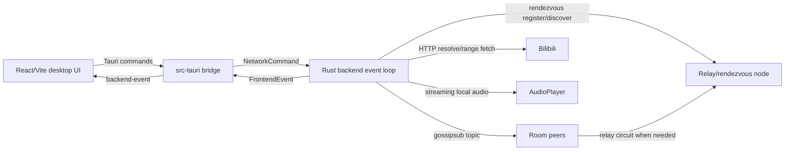

# light-ear architecture

`light-ear` is a P2P chat and shared listening app. It synchronizes chat, queue edits, votes, and playback. Listeners resolve Bilibili audio locally and exchange verified pieces of user-selected audio files.

This document describes the current implementation boundaries. Runtime commands and examples live in `README.md`; repeatable real-world checks live in `docs/manual-smoke-test.md`.

## System Shape

The desktop path is the primary product path. The legacy terminal UI has been removed; the root crate now builds the backend library plus the relay/rendezvous binary.

## Runtime Processes

- Client backend: `src/backend.rs`
  - Owns the libp2p `Swarm`, command receiver, UI event sender, history cache, music state, connection state, streaming audio events, and periodic timers.
- Desktop bridge: `src-tauri/src/main.rs`
  - Translates Tauri commands into `NetworkCommand`.
  - Emits backend `FrontendEvent` values to the webview as `backend-event`.
- Desktop UI: `desktop/src/main.jsx`
  - Renders setup, chat, player, queue drawer, vote modal, network topology, and status log.
  - The room browser and in-room peer indicator open the same topology graph. Its desktop event contains public room membership and reciprocal peer links. The client adds locally observed sockets, including infrastructure connections, and exposes their diagnostics when a node is selected.
  - Does not own protocol truth; it reflects backend events and invokes backend commands.
- Relay/rendezvous server: `src/bin/light-ear-relay.rs`
  - Provides circuit relay and rendezvous server behaviours.
  - Hosts a local topology dashboard for relay-observed state.

## Module Map

- `src/core.rs`
  - Public/shared data model: `WireMessage`, `FrontendEvent`, `NetworkCommand`, queue/playback/vote views, chat records, and small pure helpers.
  - Changes here are often wire/API changes. Keep them deliberate and backward-aware.
- `src/backend.rs`
  - Integration layer. It translates commands, wire messages, and swarm events into state-machine calls, then performs side effects.
  - Side effects include `swarm.dial`, `swarm.close_connection`, publish helpers, UI sends, Bilibili HTTP work scheduling, and audio player calls.
- `src/music_state.rs`
  - Internal pure-ish music state machine for queue, playback phase, pending prepare, playback version, and active vote.
  - This is where most queue/playback/vote rules should be tested.
- `src/buffer_state.rs`
  - Internal buffer quorum coordinator for start, seek, and resume operations.
  - It tracks short-lived operation ids, expected real room peers, local/remote buffer status, quorum readiness, timeout, and impossible quorum.
- `src/media_cache.rs`
  - Range-cache support for long media: byte-range mapping, merge/gap tracking, HTTP Range probing, deterministic cache paths, and cache eviction helpers.
  - Streaming playback uses this module for local Bilibili media cache; unsupported Range is a recoverable media failure.
- `src/connection_state.rs`
  - Internal connection strategy layer for routes, direct addresses, gossipsub warmup, chat subscription readiness, direct promotion backoff, and relay handoff.
  - This module returns effects; `backend.rs` performs the libp2p calls.
- `src/bilibili.rs`
  - Bilibili resolve and signing helpers.
  - Prefer deterministic helper tests for URL/signature/media selection changes.
  - Resolve selects plausible media URLs and does not run decoder probes; decode
    failures converge through streaming prepare.
- `src/player.rs`
  - Local audio output, volume/position control, HTTP Range streaming prepare, background decode, and local cache progress events.
  - Volume is local-only and must not enter shared playback wire state.
  - The default build uses Symphonia native AAC. The opt-in
    `fdk-aac-decoder` feature swaps in the FDK AAC Symphonia adapter for
    broader AAC support.
- `src/playback_health.rs`
  - Internal active-playback buffer-health quorum state for majority-loss pause decisions.

## Backend Event Loop

`run_network` is the external backend entrypoint. It builds the libp2p swarm, sets timers, listens/dials configured addresses, and then handles these inputs in one async loop:

- `NetworkCommand` from the Tauri bridge.
- libp2p `SwarmEvent`.
- periodic history/queue summary sync.
- periodic playback state publication by the playback leader.
- direct promotion retry tick.
- gossipsub warmup / relay handoff tick.
- rendezvous register/discover ticks.
- streaming audio prepare/cache/health events.

The event loop should stay responsive. Bilibili Range fetch and Symphonia decode work run outside the main swarm loop, and stale stream events are ignored by playback session id, buffer operation id, and track id.

## Wire Messages And Source Validation

Room protocol messages are JSON `WireMessage` values inside a room-scoped packet. Both v3 forwarding trees carry the same public room topic over separate gossipsub protocol IDs. The signed publisher and packet ID identify a publication across retries.

`HistoryRequest`, `HistoryResponse`, `QueueRequest`, and `QueueResponse` keep their `target` fields, but they are still broadcast over gossipsub and ignored by non-target peers. If gossipsub reports `NoPeersSubscribedToTopic`, the backend reports a status error and does not attempt direct request-response fallback.

`AllQueuesFull` is a recoverable congestion outcome. It should be reported as a
low-noise status where the caller has UI context, but it must not unwind
`run_network` or abort playback/queue/vote state machines. Authoritative state
can converge through the normal periodic state and summary republish paths
after gossipsub queues recover.

Forwarding-tree changes schedule a history and queue sync burst. History summaries include a digest of retained IDs. The response sends missing records in pages targeting 48 KiB of records per gossipsub publication.

Event-triggered sync is coalesced. Connection, subscription, and mDNS discovery
events can arrive in bursts for the same peer through multiple addresses, so
immediate name/history/queue summaries and music snapshots have short minimum
intervals, and follow-up summary bursts are merged instead of stacked. The
periodic summary and playback-state timers remain the steady convergence path.

Inbound gossipsub messages use source validation against the authenticated source peer:

- chat/name/history summary/request actors must match the source;
- queue state `updated_by` must match the source;
- playback state/prepare leader must match the source;
- playback ready peer must match the source;
- playback buffer prepare/cancel leader must match the source;
- playback buffer status peer must match the source;
- playback buffer health peer must match the source;
- vote proposer/ballot peer must match the source.

This validation is why deterministic vote application is local-only on most peers: for playback votes, every peer applies the same state locally from the proposal timestamp and proposer identity, but only the peer whose id matches the resulting `leader_peer_id` publishes the playback state.

## Networking Topology

Peers can meet in three ways:

- explicit peer multiaddrs from config;
- mDNS on LAN, unless disabled;
- relay/rendezvous discovery.

Clients bootstrap through the shared `light-ear.network.v3` rendezvous namespace. A desktop can browse before joining. Changing rooms keeps the identity and swarm and resets local chat, queue, audio and voting state. Clients require a coordinated upgrade. The relay can continue providing standard libp2p circuit and rendezvous services.

- `src/directory.rs` signs per-origin membership and reachability records. Directory peers compare sequence summaries over an authenticated request-response protocol. Pages contain up to eight records. The directory supports 512 participants. Records refresh at 30 seconds and expire 90 seconds after issuance, with five seconds of future clock tolerance. Only public IP candidates are shared globally.
- `src/topology.rs` builds the graph from reciprocal link reports. A depth-first search identifies single-peer cuts. The primary forwarding tree uses path costs. The alternate penalizes reusing central edges of the primary. Both normally prefer an all-direct path. Each room needs only the branches joining its members. Ordinary peers may take up to eight foreign-room subscriptions. Renewed directory records maintain those subscriptions.
- `src/overlay.rs` drives repair dials, directory exchange, tree subscriptions and delivery probes. Each protocol instance peers explicitly with its assigned neighbors. Mesh expansion and flood publishing are disabled. Foreign-room forwarding admits publications against a shared 256 KiB/s payload budget divided among helper rooms and charged for potential outgoing copies. Only a room member dispatches room messages into application state.
- Per-tree probes measure round-trip delivery on the sender’s clock. After both trees confirm coverage, each successfully published byte receives a scheduling charge of 100 to 150 units. A worst-receiver p95 difference up to 50 ms gives both trees equal weight. Larger differences can shift sustained traffic toward the faster tree up to a 60:40 preference while both remain confirmed. A single confirmed tree takes priority immediately. The peer overview counts current-room payload received from each neighbor on each tree and resets those counts on a room change. Circuit payload and directory bytes are counted across the lifetime of the swarm. The p95 value on each tree is the worst confirmed receiver in the current room. The counters exclude transport framing and music fetched from the media provider.
- A proposal freezes its eligible room member IDs. Buffer preparation snapshots live room members. A temporary loss of a neighboring socket can leave the same member reachable over another branch.

Important current timings:

- Swarm idle connection timeout: 1 hour on clients and relay server.
- Rendezvous registration TTL: 2 hours.
- Rendezvous refresh interval: 1 hour.
- Rendezvous discovery interval: 30 seconds.
- Gossipsub warmup before direct promotion timeout: 5 seconds.
- Direct promotion retry tiers: 30 seconds, then 2 minutes, then 10 minutes, then suspended after the configured max failures.
- Relay handoff grace after direct connection readiness: 10 seconds.

Rendezvous discovery results for currently disconnected peers are used for the immediate disconnected dial only. They are not cached into the local peer overview. Successful connections and identify events repopulate local connection state. When the last connection to a peer closes, cached direct addresses and backoff state are cleared so the peer overview does not fill with stale `known` peers.

On graceful shutdown, clients attempt to unregister from connected rendezvous nodes before the backend exits. Crashed clients may still remain visible until the rendezvous TTL expires.

## Direct Promotion Policy

`ConnectionState` tracks route state and returns effects:

- `DialDirect`
- `CloseRelayConnections`
- `CloseEarlyDirectConnection`
- `ResetBackoff`
- low-noise status strings

Current rules:

- First rendezvous dial uses `PeerCondition::Disconnected`.
- Direct promotion uses `PeerCondition::Always`, because an existing relay connection would make `Disconnected` skip the upgrade dial.
- Relay-only peers wait for chat subscription readiness or gossipsub warmup timeout before direct promotion.
- Direct dial failure and DCUtR failure update the same backoff.
- Direct failure must not close relay routes.
- Clients reserve inbound capacity at configured relays and up to two relays learned from circuit seeds or established outbound circuits. A closed reservation listener is retried with bounded backoff. Public reservations are included in signed presence even when the peer has many direct addresses.
- After a bridge disappears, clients try direct introductions and independently schedule bounded circuit repairs for unreachable room members and previously reachable discovery peers. This also reconnects browsers before they join a room. A repair can use the destination's advertised reservation or try its peer ID at a locally known relay. The two endpoints stagger their attempts so the opposite direction can recover a one-sided reservation. Private relay addresses stay local.
- A newly established direct route does not immediately close relay. Circuit retirement requires a verified alternative. The overlay observes the underlying connection for inbound gossipsub deliveries and probes for a replacement path.
- If direct drops during handoff grace, the relay route remains the reliability path.
- Early direct connections before warmup readiness may be closed directly, but this should close only that direct connection, not the relay route.

## Music State

`MusicState` owns:

- queue and queue version;
- playback phase: idle, preparing, or active;
- pending playback readiness;
- playback version;
- active vote.

`backend.rs` owns the effects around that state:

- publishing queue/playback/vote messages;
- sending UI views;
- scheduling Bilibili downloads;
- controlling `AudioPlayer`.

### Queue Rules

- Enqueue always appends and does not require a vote.
- The Tauri/backend command still accepts `position` for compatibility, but position has no behaviour.
- Move always requires a vote.
- Remove is direct only for the peer that requested the queue item. Other peers must vote.
- Remove/move execution is based on `item_id`, not display index.
- Queue snapshots are ordered by updated timestamp first, then version tie-break.

### Playback Rules

- The queue head’s requester leads its start while present. If the requester leaves, the first remaining member in peer-ID order takes over.
- The expected ready set includes real room peers only: local peer included, relay/rendezvous infrastructure excluded.
- New start, seek, and resume paths use `PlaybackBufferPrepare`,
  `PlaybackBufferStatus`, and `PlaybackBufferCancel` as temporary coordination
  messages before publishing a playable `PlaybackState`.
- During active playback, peers publish `PlaybackBufferHealth` with local buffer
  health. If the leader sees healthy peers below strict majority for 3 seconds,
  it publishes a paused state and starts a resume buffer operation.
- Local cache progress can update the desktop frequently, but
  `PlaybackBufferHealth` publishes are rate-limited so fast decode/download
  progress cannot fill gossipsub peer queues. Status changes publish
  immediately. Ordinary progress requires a wall-clock interval and actual
  buffer advancement. Ready coverage reaching track end is sent immediately
  once. The leader caps both fresh and stale buffer requirements at the track
  duration. At decoder EOF, a subsecond difference from the whole-second
  Bilibili duration counts as complete for health. The desktop still receives
  the measured cache range.
- `PlaybackState` remains the only authoritative room playback state. Buffer
  operations and health messages are short-lived and should be cleared or
  superseded by ready, cancel, timeout, impossible quorum, or session changes.
- Buffer quorum is a strict majority of real room peers. Prepare reserves the exact queue item and moves its title into the desktop player. A successful start or terminal failure consumes the reservation. Supersession releases it. The leader allows up to 90 seconds for each preparation. The readiness display shows ready members, total eligible members and the required majority.
- During a current buffer operation, peer disconnects and libp2p gossipsub
  `SlowPeer` reports remove that peer from the expected set and recompute quorum.
  Temporary prepare/status publish failures are visible status events, not
  reasons to abort local prepare, local ready, or leader-side quorum resolution.
- Local output availability must not block the room. If the default output
  cannot be opened, the peer reports prepare/quorum readiness so other peers can
  continue, shows a local status, and keeps retrying output recovery while
  playback or buffer preparation is active.
- If remote authoritative playback or a remote buffer prepare supersedes a local
  buffer operation, the local operation is abandoned and canceled without
  removing its queue item. The resulting local `stream canceled` event is stale
  cleanup, not a media failure.
- Local audio player events are accepted only when their operation/session/track
  still matches the current buffer operation or room playback state. This keeps
  canceled downloader/decoder tasks from publishing stale health, stale cache
  views, or late failures for a session that has already been superseded.
- Follower-side local media failure stops local audio and clears the local
  playback view, but it keeps the room playback state in `MusicState` so queue
  sync or peer churn cannot accidentally trigger the next queued item.
- Output-open failures include the cpal host, default-device description, and
  stable device id when available. This is especially useful for Linux/Wayland
  reports where PipeWire/ALSA default device configuration may be missing even
  though the rest of the room state is healthy.
- Audio output opening intentionally follows rodio's default-sink fallback
  strategy: try the default device first, then enumerate alternative non-null
  output devices. Calling `DeviceSinkBuilder::from_default_device()` alone is
  too strict on some Linux systems because querying `alsa:default` config can
  fail even when another usable output sink exists.
- Direct seek by the current track requester still avoids a vote, but it pauses
  first and waits for buffer quorum before publishing the target anchor.
- `PlaybackReady` counts only when the local peer is leader, session matches, and the ready peer is expected.
- Duplicate or unknown ready messages do not change ready count.
- Peer disconnect removes that peer from pending expected/ready sets; if all remaining expected peers are ready, playback may start.
- Idle playback state does not block starting the next queued item.
- Track finish is normalized to idle, then the leader tries to start the next queued item.

### Vote Rules

- Pause, resume, and skip always require a vote.
- Seek is direct only for the current track requester. Other peers must vote.
- Empty queue or no active playback should be rejected before creating a vote.
- Vote thresholds count real room peers only.
- Each peer may cast one ballot.
- Votes resolve early when they reach majority or when remaining pending peers can no longer make the vote pass.
- Ballots for non-current vote ids are ignored.
- Stale queue/playback proposals are rejected on receipt.
- Future queue-version remove/move proposals can wait for queue sync; if the vote passes before sync arrives, execution waits until the matching queue snapshot is applied.
- Same-session playback state refreshes should not cancel playback votes. Session or track changes should cancel relevant playback votes.

## Bilibili And Audio

Bilibili uses HTTP Range. Local audio uses the same sparse player byte cache and decoded readiness window. A native picker starts a cancelable background import. The signed room descriptor binds the sharer, title, format, length, duration, sparse seek points and SHA-256 root. The uploader keeps the file and its disk-backed Merkle index. A listener verifies each 64 KiB piece against its index and exact length, including the short final piece.

The binary `/light-ear/media/1` protocol carries requests, availability and pieces between established reciprocal tree neighbors. Gateways combine outstanding requests for identical pieces. Both trees can carry distinct pieces concurrently. Confirmed delivery time, pending bytes and advertised upload utilization influence supplier selection. Device upload limits include foreign-room traffic, which also spends the existing room transit budget. Public circuits follow the overlay's health policy. Signed directory observations expose per-edge media bytes and the worst room receiver's p95.

An MP3 decoder starts at the indexed frame before its target, including reservoir preroll. Up to four adjacent pieces can be in flight through the last indexed frame needed for the 12-second readiness window. A new seek drops the previous decoder's outstanding demand. Buffer prepares carry the planned commit version so a late pre-seek pause cannot redirect the follower's decoder.

Temporary pieces and inclusion proofs share a 512 MiB disk budget. Decoder requests and the active window take priority over queue lookahead. A replacement coordinator continues the current local-audio session after signed membership or confirmed route loss establishes the previous leader's departure. Missing pieces are retried within the existing preparation deadline.

While the current track has 15 seconds of decoded audio ahead or is buffered through its end, each listener can prefetch the first 2 MiB of the next two queue entries, one at a time. A verified shorter final range covers an entire small file. The player retains the bytes with the local media source and its verified length for up to ten minutes. Queue changes evict displaced entries and foreground buffering cancels pending work. At the next start the normal decoder consumes the cached opening and the downloader continues with missing ranges. Readiness and the room start anchor still come from the usual buffer quorum.

For DASH audio with a complete MP4 movie header and segment index in the cached opening, the decoder can read the first fragment immediately at position zero. Seeks and other MP4 layouts use the seekable format probe.

Bilibili API requests use matching Chrome user-agent and client-hint headers.
WBI playurl uses `fnval=4048`, `try_look=1`, `web_location=1550101`, and fresh
`dm_*` fingerprint fields with screen dimensions retained for the process.
Signing removes `!'()*` from values, sorts keys, and form-encodes the query
before hashing; the same encoded query is sent without a second encoding pass.
Nav and WBI playurl use the homepage Referer, while video metadata and media
Range requests retain the video Referer. Anonymous nav code `-101` is accepted
when WBI data is present; other nonzero API codes are errors even with data.

A progressive-only WBI result, missing supported media or HTTP 412 triggers a second DASH lookup on the legacy endpoint. If both endpoints offer only combined media, the player uses a single-file progressive stream with a 32 MiB startup budget. The stream worker resolves local media and performs range reads asynchronously. Enqueue lookups complete in submission order and are canceled when switching rooms.

Bilibili DASH audio may include `SegmentBase` byte ranges for fragmented MP4
initialization and index metadata. These ranges are carried as optional media
hints on `PlaybackTrack`; old messages without them still deserialize, and the
fields are not room playback truth. The streaming cache requests those
metadata ranges before playback-window or seek ranges so Symphonia can probe the
container with the required init/index data instead of failing on an isolated
`.m4s` fragment.

AAC decoding is feature-gated. Default local builds use Symphonia's native AAC decoder and only prefer AAC-LC media (`mp4a.40.2`). `cargo check --features fdk-aac-decoder` enables `symphonia-adapter-fdk-aac`, registers its AAC decoder instead of native AAC, and allows HE-AAC candidates (`mp4a.40.5` / `mp4a.40.29`). CI checks both decoder modes, and release workflows build with `fdk-aac-decoder` enabled.

Range fetch and decode run outside the main swarm event loop. Skip/cancel/vote messages can arrive while media work is in flight. Player events must be checked against the current session id, operation id, and track id before changing quorum or playback state.

Long media uses a rolling in-memory byte cache and PCM window. Decoder-requested offsets and initialization metadata survive eviction outside the estimated playback window. The downloader caps speculative lookahead at 8 MiB and validates the status, byte span and body size for every partial response. The ready window is 12 seconds, with low and high watermarks at 5 and 15 seconds.

Audio output device errors are local recoverable events. When the rodio/cpal
stream reports an error, the backend reopens the current default output device
and reattaches the current sink at the local playback position when possible.
The player also polls the default output device id every second while playing
and every five seconds while idle, which provides a cross-platform default
device change watcher without platform-specific callbacks. This recovery must
not publish a room playback change or mark the media session failed by itself.
If an output error or device-change event arrives while no track/session is
loaded, the backend drops the stale output handle and reopens lazily on the next
playback prepare instead of repeatedly rebuilding an idle stream.

When seek targets a position outside the decoded window, the player restarts the
streaming prepare at that target and prioritizes the byte ranges requested by
the demuxer/decoder. It must not wait for earlier sequential download progress
to naturally reach the new position. Existing downloaded byte ranges are kept;
only the stale decoder token and PCM window are replaced when the track/session
matches. If the demuxer cannot seek to the requested target, the current buffer
operation should fail explicitly instead of silently decoding from an older base
position. During the active seek operation, local cache and buffering events are
accepted only when they carry that operation id.

## Frontend Contract

The frontend talks to Rust through stable Tauri commands:

- `start_backend`
- `send_chat`
- `enqueue_bilibili`
- `show_queue`
- `pause`
- `resume`
- `seek`
- `set_volume`
- `skip`
- `remove_queue_item`
- `move_queue_item`
- `vote`

The backend sends `FrontendEvent` values. The event shape is intentionally UI-facing and not the same as the P2P wire schema. Peer overview, local cache progress, and status logs are diagnostic UI state; do not add P2P wire fields solely to support presentation.

Status log export is a desktop file-system operation. The frontend serializes
the current UI log entries as JSONL and calls a Tauri command; Rust uses the
Tauri dialog plugin to show a save dialog, writes to the selected path, and
returns the saved path. The desktop app should not rely on WebView Blob download
behavior for this export.

Clipboard-based queue auto-fill uses a Rust-side Tauri clipboard-manager command
first, with WebView `navigator.clipboard` only as a fallback. The Rust command
runs clipboard reads off the main thread so Linux clipboard providers cannot
freeze the app while serving data.

The desktop UI should keep these behaviours:

- queue add form only appends;
- queue reorder creates move-vote commands;
- chat composer handles IME composition before Enter submit;
- chat history remains scrollable and only auto-follows when already near the latest message;
- peer display names are aliases, not identities;
- scrubber cache progress shows local decoded/cache progress behind playback progress;
- volume is local-only.

## Relay/Rendezvous Server

`light-ear-relay` combines:

- libp2p relay server;
- rendezvous server;
- identify and ping behaviours;
- an HTTP dashboard showing relay-observed peers and rendezvous registrations.

The dashboard cannot see direct P2P edges unless clients later report them explicitly. It should be treated as relay/control-plane diagnostics, not a full room graph.

## Testing Strategy

Prefer focused unit tests around state-machine and protocol rules before large refactors.

Useful checks:

- `cargo test --lib`
- `cargo check`
- `cargo check --bin light-ear-relay`
- `cargo check --manifest-path src-tauri\Cargo.toml`
- `npm.cmd run build`

Important coverage areas:

- history insertion and summary convergence;
- queue version ordering and vote execution by `item_id`;
- playback position math and stale download handling;
- vote thresholds, stale proposal rejection, and deterministic local vote execution;
- address normalization and relay/unspecified/wrong-peer filtering;
- direct promotion backoff, relay handoff, and failure paths that must not close relay;
- Bilibili signing and media selection fallbacks.

For real network behaviour, use `docs/manual-smoke-test.md`. A good smoke room has one relay-only peer, one direct-capable peer, and one slower or unstable peer.

## Change Guidance

- Do not change `WireMessage`, `FrontendEvent`, or Tauri command shapes casually.
- Keep network side effects in `backend.rs`; keep policy decisions in state modules where they can be unit tested.
- Add or update tests when changing protocol rules, state transitions, connection promotion, playback/vote behaviour, or Bilibili resolution.
- Update this document and `AGENTS.md` when architecture boundaries, timing assumptions, or workflow expectations change.
